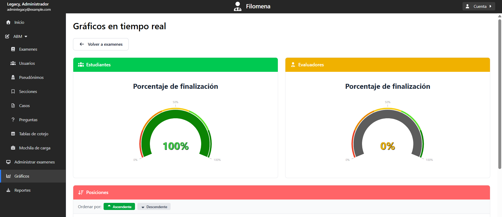
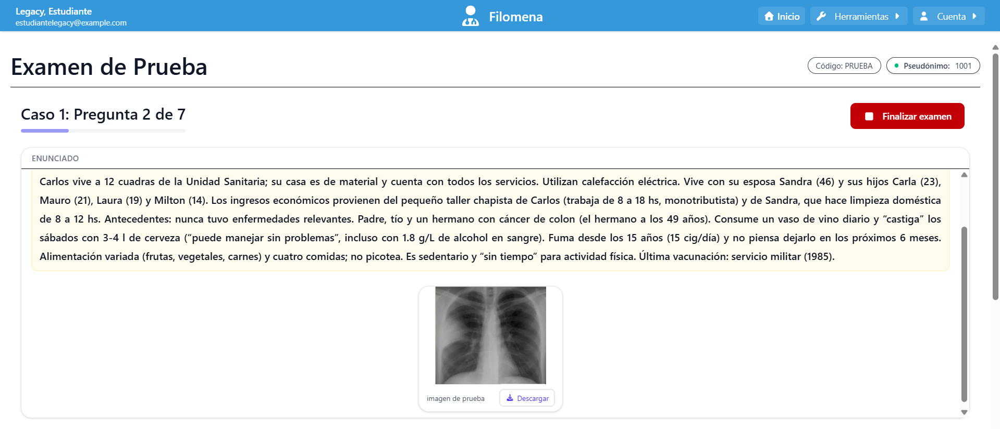
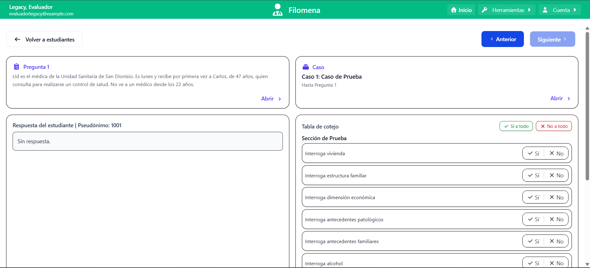
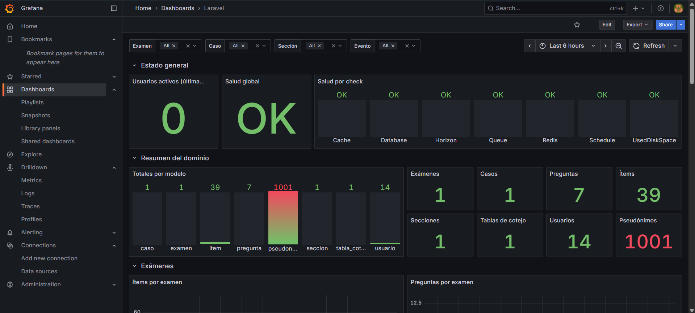
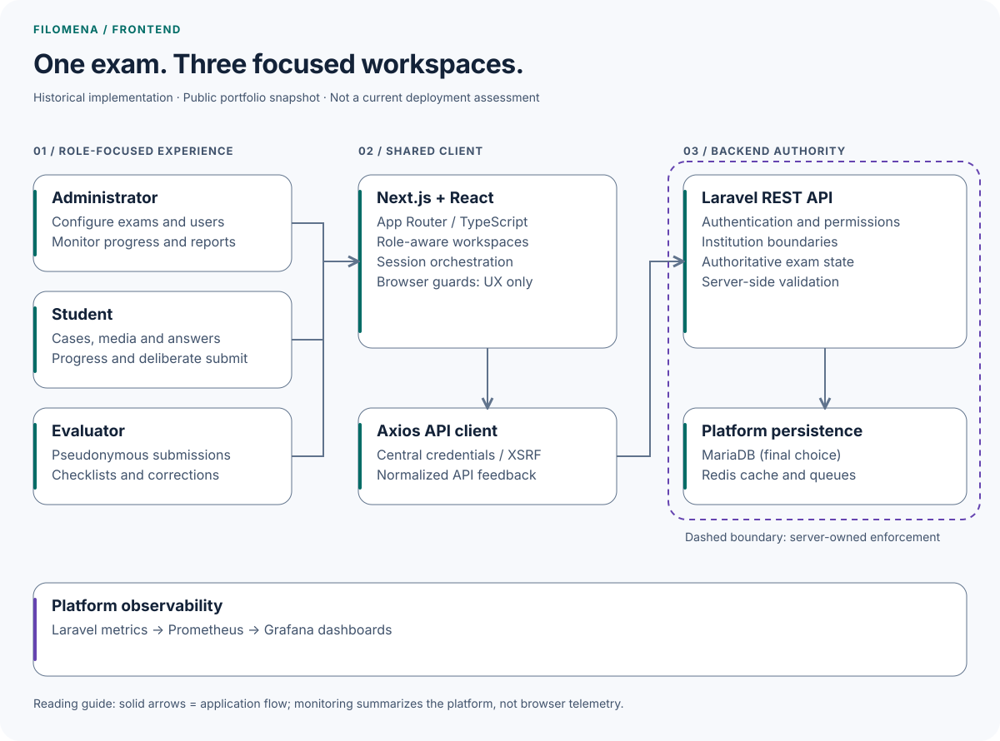
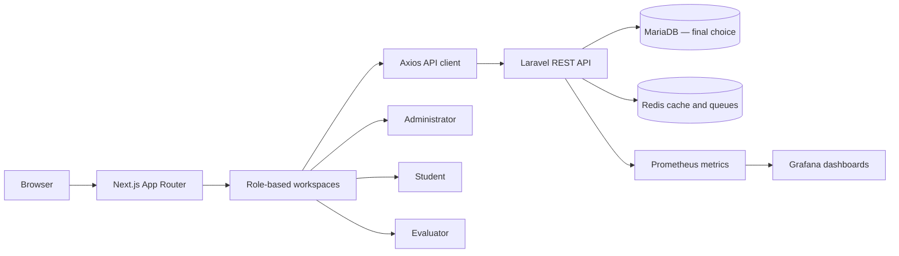

# Filomena Frontend

**A production health-sciences exam experience built for high-stakes, multi-role workflows.** Filomena turns exam design, delivery, evaluation, and live operations into one web platform used by five Argentine national institutions.

Historical public snapshot, maintained by Gonzalo Martin Perez as technical portfolio evidence. Versions and delivery configuration describe the published implementation.

[](https://nextjs.org/)
[](https://react.dev/)
[](https://www.typescriptlang.org/)
[](https://www.docker.com/)

| Verified platform outcome                        |      Result |
| ------------------------------------------------ | ----------: |
| Institutions using Filomena                      |       **5** |
| Simultaneous exam users supported                |  **1,000+** |
| Average response time on critical API endpoints  | **<300 ms** |
| End-to-end institutional deployment              | **<15 min** |
| Universidad Nacional del Sur final-project grade |   **10/10** |

[Read the case study](#case-study) · [Explore the backend](https://github.com/gonzalomartinperez/filomena-backend)

> The metrics above describe the complete Filomena platform, not the frontend in isolation. Screenshots use demonstration data and `example.com` identities.



## Why Filomena exists

Health-sciences exams combine strict timing, heterogeneous content, multiple evaluators, student anonymity, and a need for reliable reporting. Filomena replaces a CakePHP + jQuery monolith with a decoupled, API-first system whose frontend gives each role a focused workspace:

- **Administrators** configure exams, users, sections, cases, questions, checklists, bulk imports, files, monitoring, and reports.
- **Students** enter an assigned exam, navigate case-based questions, work with supporting media, preserve progress, and submit deliberately.
- **Evaluators** review pseudonymized submissions, inspect case context, complete structured checklists, and finalize corrections.

## Product tour

### Student exam workspace

Case context, supporting media, progress, and answers remain in one focused flow.



### Evaluator workflow

Evaluators work against pseudonyms and structured criteria instead of direct student identity.



### Operational visibility

The platform combines role-specific live progress with infrastructure observability.



## Architecture

<p align="center">
<picture>
  <source media="(prefers-color-scheme: dark)" srcset="docs/diagrams/architecture-dark.svg">
  
</picture>
</p>

The overview groups responsibilities in the published implementation. The editable logical view below retains the detailed relationships; neither view changes the historical architecture. [Diagram source and maintenance](docs/diagrams/README.md).

<details>
<summary>Detailed logical view · editable Mermaid</summary>



</details>

This repository is the Next.js client. Authentication, authorization, tenant isolation, persistence, and authoritative exam state belong to the backend. Client-side route and role guards improve the user experience; they are not treated as the security boundary.

Database history: the project used both MySQL and MariaDB during its development; MariaDB was the final relational database selection. The team chose MariaDB Server as a community, open-source foundation that met Filomena's requirements without depending on commercial features. The diagrams show that final choice. [MySQL Community Edition](https://www.mysql.com/products/community/) is open source under the GPL, and [MariaDB Server](https://mariadb.org/about/) is open source under GPLv2.

## Frontend engineering

- **Next.js App Router + React + TypeScript:** 42 route pages organized around administrator, student, and evaluator domains.
- **Role-aware session orchestration:** authentication context, selected-role persistence, controlled redirects, periodic session refresh, and a forced password-change flow.
- **Centralized API behavior:** one Axios client attaches bearer credentials, supports cookie/XSRF flows, and normalizes network and API feedback.
- **Reusable interaction layer:** generic forms, data grids, upload dropzones, file previews, modals, toast notifications, loading states, and report actions.
- **Safer long-form editing:** an unsaved-changes guard covers internal navigation, browser history, reloads, and tab close.
- **Operational workflows:** spreadsheet imports, document uploads, PDF/Excel reporting, fuzzy search, live progress gauges, and pseudonymized evaluation.
- **Reproducible delivery:** deterministic npm installs, a standalone Next.js build, a multi-stage Docker image, a non-root runtime user, and a container health check.

## Repository map

```text
src/
├── api/                         Central Axios client and interceptors
├── app/
│   ├── components/              Shared UI and workflow primitives
│   ├── contexts/                Authentication, modals, and notifications
│   ├── ingresar/                Sign-in and account recovery
│   └── inicio/
│       ├── administrador/       Exam configuration and operations
│       ├── estudiante/          Exam-taking experience
│       └── evaluador/           Pseudonymous correction workflow
docker/                          Multi-stage production image
public/                          Runtime-safe static assets
```

## Security and privacy design

- Three application roles are separated into dedicated workspaces and API flows.
- Student-facing and evaluator-facing workflows use pseudonyms where direct identity is unnecessary.
- API calls support bearer authentication plus credentialed/XSRF-aware requests.
- First-login password rotation is represented explicitly in the client flow.
- The production image runs as an unprivileged user.
- Real credentials, institutional import templates, production data, and private deployment configuration are intentionally absent from this public snapshot.

Never rely on frontend checks for authorization. The Laravel API must enforce permissions, institution boundaries, exam state, and data validation for every request.

Report vulnerabilities privately by following [SECURITY.md](SECURITY.md). Do not publish exploit details, credentials, or institutional data in a public issue.

## Local development

### Prerequisites

- Node.js **24.19.0**
- npm **11.19.0**
- A running [Filomena backend](https://github.com/gonzalomartinperez/filomena-backend)

### Start the app

```bash
cp .env.example.local .env.local
npm ci
npm run dev
```

Open `http://localhost:3000`. The example environment targets a backend at `http://localhost:8000/api`; adjust `NEXT_PUBLIC_API_URL` for your deployment.

No default login is published here. Create development users through the backend's documented local setup.

### Validation

```bash
npm audit
npm run lint
npm run build
```

Run the audit against the current advisory database; an earlier clean install is not a permanent security guarantee. ESLint checks the source tree, and the production build includes TypeScript validation. The public snapshot does not include an automated frontend test suite. These commands describe available checks, not newly executed results.

## Docker

```bash
cp .env.example.docker .env
./run.sh prod --build
```

The image uses Next.js standalone output and runs as a non-root user. The script changes `.env` and stops the named development and production projects before starting the selected mode; it is not a zero-downtime deployment command. Use a distinct `COMPOSE_PROJECT_NAME` and available local port.

`./run.sh off` stops both named modes while retaining volumes. `./run.sh reset` also deletes their volumes and orphan containers: use it only for disposable local data. The published port is not restricted to loopback in the Compose file; review host exposure before starting. Neither the `prod` argument nor the historical Docker configuration constitutes a current production-readiness assessment.

## Public-snapshot boundaries

The application still accepts `.xls`, `.xlsx`, `.csv`, and `.ods` imports. The original institutional example workbooks are not distributed in this public portfolio snapshot because they contained institution-specific sample records. Removing the downloadable examples does not change the import API or upload flow.

The original team photos and external profile links are also excluded. The in-app credits preserve team attribution without republishing personal media.

## Case study

Filomena began as a final project at Universidad Nacional del Sur and became a production platform adopted by **UNS, UNRN, UNC, UNVM, and FAMFyG**.

The modernization replaced a CakePHP + jQuery monolith with a Laravel REST API and this Next.js/React/TypeScript client. At platform level, the system supported **1,000+ simultaneous exam users** and kept critical API responses below **300 ms** through SQL tuning and Redis caching/queues. It reduced institutional onboarding from hours to minutes, while Docker and GitHub Actions brought end-to-end deployments below **15 minutes**. The platform also added Prometheus/Grafana observability, multi-role RBAC, student anonymity, and per-institution data isolation.

[Read the complete English case study](https://vine-jupiter-8df.notion.site/Filomena-Production-Health-Sciences-Exam-Platform-367b68807486814ca99ad189ca70ff00)

## Evidence

- [English case study](https://vine-jupiter-8df.notion.site/Filomena-Production-Health-Sciences-Exam-Platform-367b68807486814ca99ad189ca70ff00)
- [Spanish case study](https://vine-jupiter-8df.notion.site/Filomena-Plataforma-Productiva-de-Ex-menes-de-Ciencias-de-la-Salud-29ab68807486806db025cfeef5de9f73)
- [Verified academic record](https://vine-jupiter-8df.notion.site/Academic-Record-Information-Systems-Engineering-UNS-367b68807486817db09bc3f178ae0ffb)
- [Gonzalo Martin Perez — English CV](https://rxresu.me/gonzalomartinperez/gonzalo-martin-perez-software-and-ai-engineer-en-2026)

## Authorship and portfolio context

Filomena v2 was built as a **three-person engineering capstone**, and the product remains a team achievement. This public repository is maintained by **Gonzalo Martin Perez** as verifiable portfolio evidence. His documented project scope spans architecture through production deployment, including the API-first modernization, the Next.js/TypeScript frontend, performance work, deployment automation, observability, and production safeguards described above.

The source is published for technical evaluation and portfolio review. No open-source license has been added; absence of a license does not grant reuse or redistribution rights.

## Maintenance and security

This is an owner-maintained portfolio reference, not a community support service. See [CONTRIBUTING.md](CONTRIBUTING.md) for scope and validation, and [SECURITY.md](SECURITY.md) for private reporting and safe handling of institutional data. The application source and dependencies are preserved as a historical university-project snapshot, with no automatic dependency maintenance or routine upgrade program. `develop` is retained for documentation corrections through reviewed PRs into `main`; the two branches are kept synchronized after promotion. Historical dependencies may have known security advisories; the snapshot is not a current deployment recommendation.
